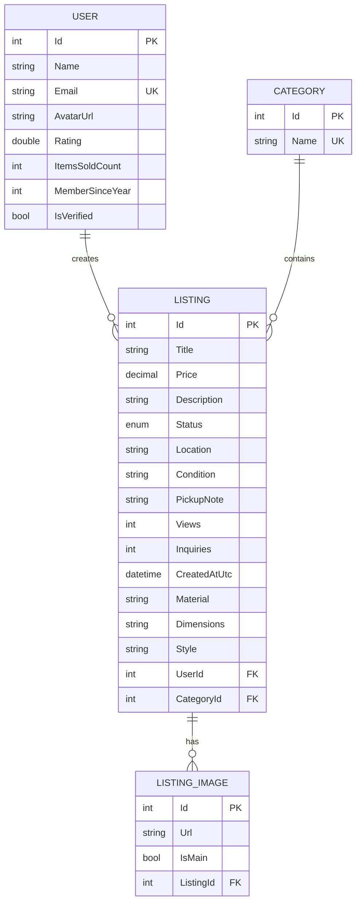

# NearBuy

A mini local marketplace where users can post, browse, and comment on secondhand or unused items — built as a university team web project.

# What it does

NearBuy lets people list items they want to sell (furniture, electronics, textbooks, anything) and lets others browse, search, and ask questions directly on the listing via comments — no messaging system, no accounts required just to browse.

Core loop: post an item → someone finds it → they comment to ask about it → deal happens outside the app.

# Pages
Listings (home) — browse all active listings, filter by category, search by keyword  
Listing detail — full item view (photos, price, description, seller, comments)  
Post a listing — create a new listing (logged-in users)  
My listings — manage your own posts: edit, delete, mark as sold  
Login / Register — basic auth  

# Branching workflow
main — stable, demo-ready state  
dev — active integration branch  
feature/<short-desc> — one branch per task, merged into dev via reviewed MR  

# Data Base ER-diagram

# Authentication (Microsoft Entra ID)

- **Tenant ID:** `70a28522-969b-451f-bdb2-abfea3aaa5bf`
- **Client App ID:** `85b29288-c033-4ba4-abff-e6fb49a2ee6e`
- **API App ID:** `6b99ada1-1ca0-4f7f-9a81-86cf13b17134`
- **Scope:** `api://6b99ada1-1ca0-4f7f-9a81-86cf13b17134/access_as_user`

# Verification Screenshots
- [API Scope (`access_as_user`)](docs/entra-id/1a-api-scope.png)
- [App Roles (`User`, `Admin`)](docs/entra-id/1b-app-roles.png)
- [Role Assignments](docs/entra-id/1c-user-assignments.png)